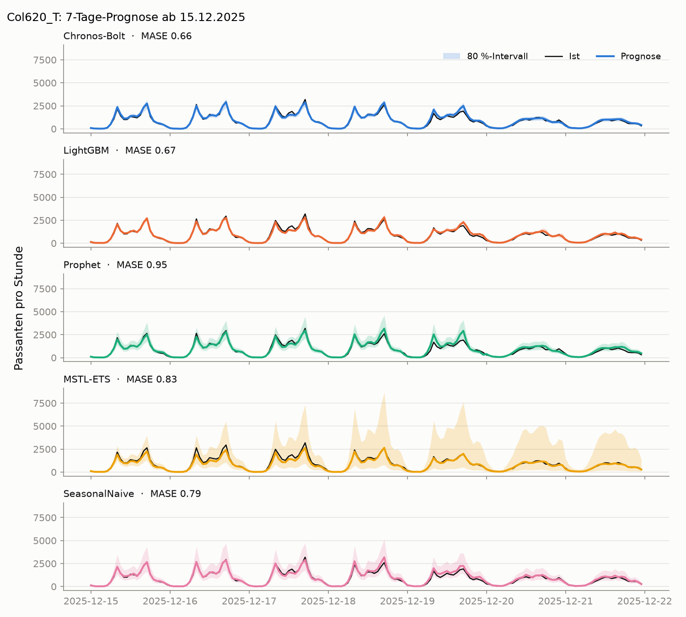
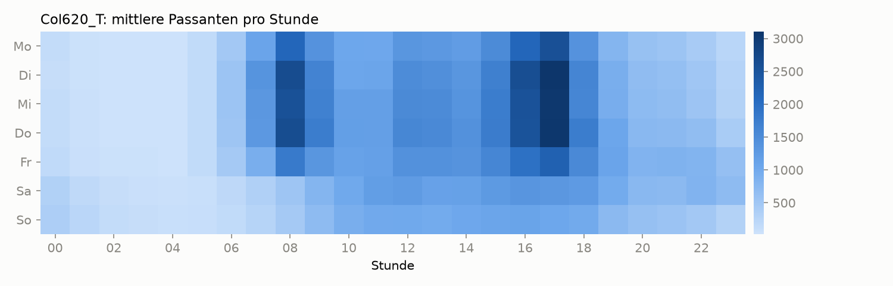

# Pedestrian Traffic Forecast

Stündliche Passantenzahlen in Melbourne vorhersagen und dabei eine Frage beantworten:
**Lohnt sich ein Zeitreihen-Foundation-Model gegenüber einem gut gebauten LightGBM?**



## Daten

- [Melbourne Pedestrian Counting System](https://data.melbourne.vic.gov.au/explore/dataset/pedestrian-counting-system-monthly-counts-per-hour/), stündlich, ~100 Sensoren. Das Portal liefert ein rollierendes 2-Jahres-Fenster, Corona-Jahre sind damit automatisch ausgeschlossen.
- Wetter: [Open-Meteo Historical API](https://open-meteo.com/en/docs/historical-weather-api) (Temperatur, Niederschlag)
- Feiertage: `holidays` (AU, Victoria), inkl. Melbourne Cup und AFL Grand Final Friday

Auswahl: 8 Sensoren mit ≥ 99 % Abdeckung und dem höchsten mittleren Aufkommen. Lücken werden aufgefüllt, aber nicht bewertet.



## Modelle

| Modell | Idee |
|---|---|
| SeasonalNaive | Wert derselben Stunde der Vorwoche |
| MSTL-ETS | log-Skala, Zerlegung in Tages- und Wochensaison, ETS auf dem Rest |
| Prophet | log-Skala, getrennte Tagesprofile für Werk- und Freitage, Feiertage, Wetter |
| LightGBM | ein globales Modell über alle Sensoren, Kalender, Wetter, Lags; je Horizont ein Modell mit Lags ≥ Horizont, Quantilmodelle für das Intervall |
| Chronos-Bolt | `amazon/chronos-bolt-base` zero-shot, 2048 h Kontext, keine Kovariaten |

## Backtest

Rollierender Ursprung: 45 Ursprünge im Abstand von 8 Tagen über das letzte Jahr (dadurch wechselt der Wochentag des Ursprungs), Horizont 24 h und 7 Tage. Metriken: MASE (Skala: saisonaler Naive-Fehler mit Lag 168 im Training), sMAPE, Abdeckung des 80 %-Intervalls.

| Modell | MASE 24 h | MASE 7 d | sMAPE 24 h | sMAPE 7 d | Abdeckung 80 % (7 d) |
|---|---|---|---|---|---|
| Chronos-Bolt | 0.749 | 0.796 | 19.6 % | 21.5 % | 80 % |
| LightGBM | **0.711** | **0.769** | 16.6 % | 18.8 % | 69 % |
| Prophet | 1.098 | 1.019 | 23.3 % | 23.0 % | 84 % |
| MSTL-ETS | 1.233 | 1.303 | 23.0 % | 26.5 % | 96 % |
| SeasonalNaive | 1.016 | 1.012 | 24.5 % | 24.6 % | 87 % |

MASE < 1 heißt: besser als der saisonale Naive-Fehler im Training. 360 Fenster je Horizont (45 Ursprünge × 8 Sensoren).

### Feiertage

| Modell | MASE normale Tage | MASE Feiertage |
|---|---|---|
| Chronos-Bolt | 0.768 | 1.572 |
| LightGBM | 0.745 | 1.420 |
| Prophet | 0.994 | 1.747 |
| MSTL-ETS | 1.253 | 2.646 |
| SeasonalNaive | 0.979 | 1.938 |

### MASE pro Sensor (7 d)

| Sensor | Chronos-Bolt | LightGBM | Prophet | MSTL-ETS | SeasonalNaive |
|---|---|---|---|---|---|
| Col620_T | 0.93 | **0.86** | 1.16 | 1.25 | 1.03 |
| ElFi_T | 0.76 | **0.72** | 0.93 | 1.28 | 0.99 |
| PriNW_T | 0.75 | **0.71** | 0.84 | 1.14 | 0.96 |
| QVN_T | 0.84 | **0.81** | 1.10 | 1.17 | 1.10 |
| SouthB_T | 0.81 | **0.71** | 1.13 | 1.45 | 1.03 |
| Swa123_T | 0.79 | **0.75** | 1.06 | 1.62 | 1.01 |
| Swa295_T | 0.84 | **0.83** | 1.06 | 1.12 | 1.13 |
| Swa31 | **0.65** | 0.76 | 0.88 | 1.39 | 0.86 |

## Erkenntnisse

**Kurz: LightGBM gewinnt knapp, Chronos-Bolt kommt ohne jedes Training fast heran.**

- **Genauigkeit:** LightGBM liegt bei MASE 0.71 (24 h) und 0.77 (7 d), Chronos-Bolt bei 0.75 und 0.80, also 4–5 % dahinter. Pro Fenster gewinnt LightGBM 164-mal, Chronos 130-mal. Alle anderen Modelle liegen klar dahinter.
- **Aufwand:** Chronos braucht keine Features, kein Training und kein Tuning. Für 45 Ursprünge brauchte es 2,4 Minuten auf MPS, LightGBM mit Feature Engineering und sechs Boostern pro Ursprung rund 30 Minuten.
- **Feiertage:** Alle Modelle verdoppeln ihren Fehler. LightGBM kennt Feiertage als Feature und baut seinen Vorsprung dort aus (1.42 gegen 1.57). Das Feature allein reicht aber nicht, dafür gibt es zu wenige Feiertage im Training.
- **Kurzer Horizont:** Am ersten Tag des 7-Tage-Fensters ist Chronos besser als das 7-Tage-LightGBM (0.75 gegen 0.78), weil dieses nur Lags ab 168 h nutzen darf. Ein eigenes 24-h-Modell mit kurzen Lags holt den Vorsprung zurück.
- **Intervalle:** Chronos ist am besten kalibriert (80–84 % Abdeckung beim 80 %-Intervall). Die LightGBM-Quantilmodelle sind zu schmal (69–70 %), MSTL-ETS ist viel zu breit (96 %).
- **Überraschung:** MSTL-ETS und Prophet sind nicht besser als die Vorwoche. Für stabile Pendlerstandorte ist der saisonale Naive-Ansatz schon stark, und LightGBM verdankt rund drei Viertel seines Gains dem Mittel derselben Stunde über die letzten vier Wochen.

Für Digital Signage heißt das: Chronos-Bolt ist eine sehr gute Ausgangsbasis, die man ohne Data-Science-Aufwand für neue Standorte nutzen kann. Wer die letzten Prozent und die Feiertage braucht, baut einen LightGBM darüber.

Einschränkung: Prophet und LightGBM bekommen das tatsächlich beobachtete Wetter als Regressor (Oracle). Mit Wetterprognosen wären sie etwas schlechter. Chronos nutzt keine Kovariaten.

## Struktur

```
data/download.py        Zählungen und Wetter nach data/raw/ laden
src/features.py         Sensorauswahl, Stundenraster, Kalender, Wetter
src/models.py           alle Modelle mit einheitlicher Schnittstelle
src/metrics.py          MASE, sMAPE, Abdeckung
src/backtest.py         rollierender Backtest, schreibt results/*.parquet
src/report.py           README-Grafiken und Tabellen
notebooks/              01_eda, 02_baselines, 03_foundation
app/streamlit_app.py    lädt nur vorberechnete Ergebnisse
```

## Reproduzieren

```bash
brew install libomp      # für LightGBM auf macOS
uv sync
uv run python data/download.py
uv run python -m src.backtest     # ~45 min auf einem MacBook M5, --debug für Details, --resume nach Abbruch
uv run python -m src.report
uv run streamlit run app/streamlit_app.py
```

PyTorch und LightGBM laden unterschiedliche OpenMP-Laufzeiten, die sich in einem Prozess gegenseitig blockieren. Chronos läuft deshalb in einem eigenen Prozess.

## Deployment

Streamlit Community Cloud, Einstiegspunkt `app/streamlit_app.py`. Die App braucht nur `app/requirements.txt` und `results/`, Chronos wird nicht in der App gerechnet.
